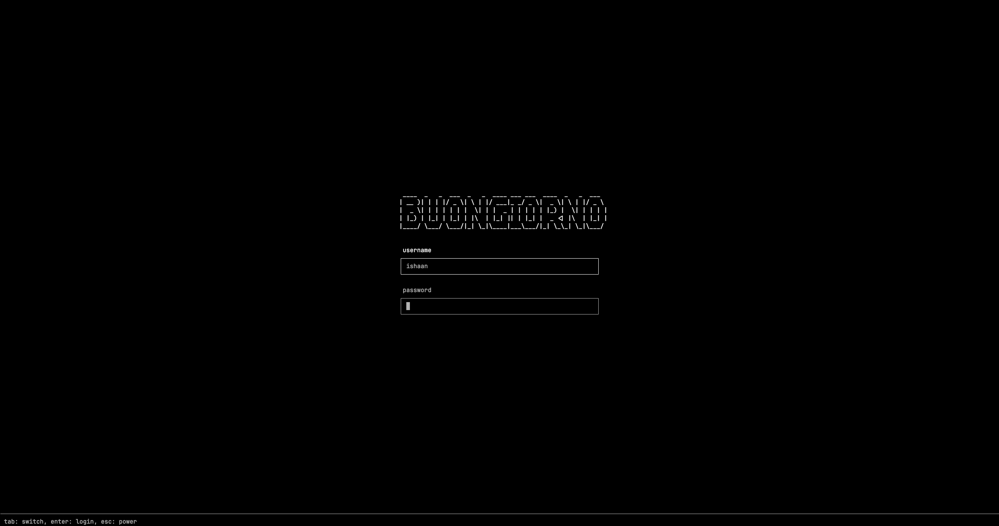

# [buongiorno]

A TUI greeter for [greetd] written in [zig] using [spoon].



## Installation

As this package isn't published on Nixpkgs, for system installation you will need to add the flake input and add the package using either the overlay or default package:

`flake.nix`:

```nix
{
  inputs = {
    flint = {
      url = "github:Ishaan-Datta/buongiorno";
      inputs.nixpkgs.follows = "nixpkgs";
      inputs.flake-utils.follows = "flake-utils";
    };
  };
}
```

Adding it using the overlay:

```nix
{ inputs, pkgs, ... }:

{
  nixpkgs.overlays = [
    inputs.buongiorno.overlays.default
  ];

  home.packages = [
    pkgs.buongiorno
  ];
}
```

Adding it using the default package:

```nix
{ inputs, pkgs, ... }:

{
  home.packages = [
    inputs.buongiorno.packages.${pkgs.stdenv.hostPlatform.system}.default
  ];
}
```

## Binary Cache

Pre-built `x86_64-linux` packages are published to a Nix binary cache backed by GitHub Pages and GitHub Releases.

### Flake configuration

Add the cache to your flake's `nixConfig`:

```nix
{
  nixConfig = {
    extra-substituters = [
      "https://ishaan-datta.github.io/buongiorno/"
    ];

    extra-trusted-public-keys = [
      "buongiorno-1:W5d2rkv6ZGelFHr/bFPNvNBPt3MASzyiGj0r0ykOADA="
    ];
  };
}
```

Nix may prompt you to accept these flake-provided configuration options the first time you use the flake.

### NixOS configuration

To configure the cache system-wide on NixOS:

```nix
{
  nix.settings = {
    extra-substituters = [
      "https://ishaan-datta.github.io/buongiorno/"
    ];

    extra-trusted-public-keys = [
      "buongiorno-1:W5d2rkv6ZGelFHr/bFPNvNBPt3MASzyiGj0r0ykOADA="
    ];
  };
}
```

After rebuilding your system, Nix will use the cache whenever a matching store path is available. You can test the cache without changing your system configuration:

```sh
nix build github:Ishaan-Datta/buongiorno \
  --option extra-substituters https://ishaan-datta.github.io/buongiorno/ \
  --option extra-trusted-public-keys \
    'buongiorno-1:W5d2rkv6ZGelFHr/bFPNvNBPt3MASzyiGj0r0ykOADA='
```

## Usage

For a machine with exactly one connected native DRM output, no new option is needed.

For a machine with multiple connected outputs, pass the connector explicitly, for example:

```sh
buongiorno -o DP-1 -u ishaan -c startplasma-wayland
```

List connected connectors with:

```sh
for output in /sys/class/drm/card*-*; do
  [ -f "$output/status" ] || continue
  [ "$(cat "$output/status")" = connected ] || continue
  printf '%s: ' "$(basename "$output")"
  head -n1 "$output/modes"
done
```

The `-o` value is the connector portion such as `DP-1`, `HDMI-A-1`, or `eDP-1`, not `card0-DP-1`.

### Keyboard controls

The username and password fields are always editable.

- `Tab` and `Shift+Tab` switch between fields.
- `Left` and `Right` move the cursor one character.
- `Up` moves to the beginning of the field; `Down` moves to the end.
- `Ctrl+A` selects all text in the field. Typing or pressing `Backspace` replaces or clears it. `Left` or `Up` moves to the beginning without deleting text; `Right` or `Down` moves to the end.
- `Enter` moves from username to password and attempts login from the password field.
- `Escape` opens the power menu.

In the power menu, use `Up`, `Down`, `Tab`, or `Shift+Tab` to select reboot, reboot into the firmware interface, or shut down. Press `Enter` to confirm the selected action and `Escape` to return to the login form.

## Attributions

I build this project as a fork of [buongiorno](https://sr.ht/~andreafeletto/buongiorno/) by [andreafelleto](https://sr.ht/~andreafeletto/) to better suit my needs.

## License

This project is licensed under GPLv3. See .
